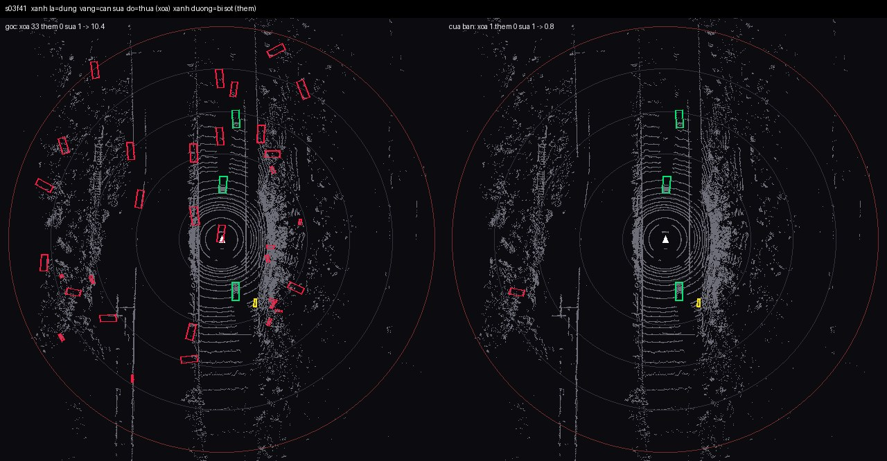

# Báo cáo Lab Day 14 — Pre-label 3D bằng PointPillars pre-trained (VF LiDAR)

- **Họ và tên:** Nguyễn Hoàng Diệu
- **MSSV:** 2A202603174
- **Seed tag:** `seed_tag=393590736f`

---

## 1. Dự đoán trước sweep (Bước 5b)

- **Kết quả đo cấu hình gốc trên Tập A (`s01f01`, `s03f41`, `s05f28`):** GT 43 hộp, dự đoán 93 hộp (khớp 36) $\rightarrow$ **Xóa 57, Thêm 7, Sửa 2 $\rightarrow$ Tổng chi phí: `25.1`**.
- **Dự đoán tham số & lý do:** Với cấu hình gốc (`score_thr=0.1`, `min_points=0`), mô hình sinh ra tới 93 hộp trên tổng số 43 vật thể thật, dẫn đến **57 hộp thừa phải xóa** (chiếm `17.1 / 25.1` tổng chi phí, đặc biệt ở `s03f41` dư 33 hộp và `s05f28` dư 17 hộp) do các dự đoán nhiễu có điểm tin cậy thấp và ít điểm LiDAR. Do đó, dự đoán việc **tăng `score_thr` (lên khoảng `0.3` – `0.4`) kết hợp tăng `min_points` (`5` – `10`)** sẽ giảm công sửa nhiều nhất nhờ lọc bỏ lượng lớn hộp giả này, đồng thời vẫn giữ lại được phần lớn các phương tiện thật gần xe.

---

## 2. Kết quả sweep và lựa chọn cấu hình (Bước 6)

- **So sánh cấu hình gốc và cấu hình tốt nhất (`best_config.json`):**
  - **Cấu hình gốc** (`score_thr=0.1`, `min_points=0`): Xóa **57**, Thêm **7**, Sửa **2** $\rightarrow$ Tổng chi phí: **`25.1`**.
  - **Cấu hình chọn** (`score_thr=0.5`, `min_points=10`): Xóa **10**, Thêm **12**, Sửa **2** $\rightarrow$ Tổng chi phí: **`16.0`** (giảm **36%** chi phí sửa trên Tập A).
- **Lý do chọn cấu hình:** Khi nâng `score_thr=0.5` và `min_points=10`, số hộp thừa phải xóa giảm mạnh từ `57` xuống còn `10` (giảm `47 × 0.3 = 14.1` điểm chi phí). Dù ngưỡng lọc cao làm tăng thêm `5` vật thể bị sót (`5 × 1.0 = +5.0` điểm chi phí), mức giảm từ việc loại bỏ hộp nhiễu vẫn lớn hơn mức phạt thêm box sót, đưa tổng chi phí xuống mức thấp nhất (`16.0`) trong 15 cấu hình thử nghiệm.
- **Đánh giá độ ổn định qua Leave-one-out:**
  - `s01f01`: chọn `score_thr=0.5, min_points=10` $\rightarrow$ chi phí **`11.2`** (so với *oracle* `8.8`).
  - `s03f41`: chọn `score_thr=0.3, min_points=10` $\rightarrow$ chi phí **`7.4`** (so với *oracle* `0.8`).
  - `s05f28`: chọn `score_thr=0.5, min_points=10` $\rightarrow$ chi phí **`4.0`** (đạt bằng *oracle* `4.0`).
  - **Nhận xét:** Cấu hình `score_thr=0.5, min_points=10` ổn định trên các frame nhiều nhiễu (`s03f41`, `s05f28`), nhưng trên `s01f01` lại làm tăng nhẹ chi phí (`11.2` so với gốc `9.1`) do lọc nhầm một số vật thể thật ở xa/ít điểm. Điều này cho thấy việc tune trên 3 frame vẫn chịu ảnh hưởng bởi đặc thù từng cảnh.

---

## 3. So sánh trước/sau và đối chiếu dự đoán 5b (Bước 8)

| Frame | Chi phí gốc | Chi phí sau tune | Chênh lệch |
|---|---:|---:|---:|
| `s01f01` | 9.1 | 11.2 | +2.1 |
| `s03f41` | 10.4 | 0.8 | -9.6 |
| `s05f28` | 5.6 | 4.0 | -1.6 |
| **Tổng** | **25.1** | **16.0** | **-9.1 (-36%)** |

- **Đối chiếu dự đoán ở Bước 5b:** Dự đoán ban đầu ở Bước 5b **đúng về hướng tác động chính** (việc tăng đồng thời `score_thr` và `min_points` thực sự giảm mạnh số hộp thừa phải xóa từ `57` xuống `10` và kéo tổng chi phí giảm `36%`, đặc biệt trên `s03f41` giảm từ `10.4` xuống `0.8`). Tuy nhiên, mức tối ưu thực tế đạt ở `score_thr=0.5` cao hơn khoảng dự đoán ban đầu (`0.3` – `0.4`), đồng thời dự đoán chưa lường hết đánh đổi trên frame `s01f01` khi ngưỡng cao làm sót thêm `5` vật thể thật (tăng chi phí thêm từ `7` lên `12`).

---

## 4. Đánh giá trên Tập B (Bước 9)

- **Kết quả tổng hợp trên 12 frame Tập B (`GT = 132` vật thể thật trong bán kính 50 m):**

| Cấu hình | Dự đoán | Khớp | Xóa | Thêm | Sửa | Tổng chi phí |
|---|---:|---:|---:|---:|---:|---:|
| Cấu hình gốc (`score_thr=0.1, min_points=0`) | 378 | 125 | 253 | 7 | 5 | **85.4** |
| Cấu hình đã tune (`best_config.json`: `score_thr=0.5, min_points=10`) | 158 | 122 | 36 | 10 | 2 | **21.8** |

- **Chi tiết từng frame với cấu hình `best_config.json`:**
  - `s01f07`: Xóa 1, Thêm 3, Sửa 0 $\rightarrow$ chi phí `3.3`
  - `s01f25`: Xóa 2, Thêm 2, Sửa 0 $\rightarrow$ chi phí `2.6`
  - `s01f56`: Xóa 4, Thêm 0, Sửa 1 $\rightarrow$ chi phí `1.7`
  - `s02f00`: Xóa 1, Thêm 1, Sửa 0 $\rightarrow$ chi phí `1.3`
  - `s02f26`: Xóa 2, Thêm 0, Sửa 0 $\rightarrow$ chi phí `0.6`
  - `s02f52`: Xóa 5, Thêm 0, Sửa 0 $\rightarrow$ chi phí `1.5`
  - `s04f00`: Xóa 1, Thêm 0, Sửa 0 $\rightarrow$ chi phí `0.3`
  - `s04f26`: Xóa 1, Thêm 0, Sửa 0 $\rightarrow$ chi phí `0.3`
  - `s04f45`: Xóa 1, Thêm 0, Sửa 0 $\rightarrow$ chi phí `0.3`
  - `s05f02`: Xóa 9, Thêm 0, Sửa 0 $\rightarrow$ chi phí `2.7`
  - `s05f17`: Xóa 1, Thêm 3, Sửa 1 $\rightarrow$ chi phí `3.8`
  - `s05f35`: Xóa 8, Thêm 1, Sửa 0 $\rightarrow$ chi phí `3.4`
- **Nhận xét:** Khi áp dụng `best_config.json` sang 12 frame độc lập của Tập B, số hộp giả phải xóa giảm mạnh từ `253` xuống còn `36` hộp, kéo tổng điểm chi phí sửa giảm từ `85.4` xuống `21.8` (giảm `63.6` điểm chi phí, tương đương ~74.5%), trong khi số vật thể bị sót chỉ tăng nhẹ từ `7` lên `10`. Công cụ pre-label giúp giảm đáng kể khối lượng thao tác dọn nhiễu ban đầu, nhưng vẫn cần người gán nhãn rà soát và bổ sung thủ công các đối tượng bị sót.

---

## 5. Giới hạn của phương pháp

1. **Tập tune nhỏ dễ gây overfit:** Việc tìm tham số chỉ dựa trên 3 frame ở Tập A không đại diện hết mọi mật độ giao thông. Ngưỡng `score_thr=0.5` và `min_points=10` lọc rất tốt hộp giả trên các cảnh nhiều nhiễu cây cối (`s03f41`, `s02f00`, `s05f35`), nhưng đồng thời làm tăng số vật thể thật bị bỏ sót ở các khung hình có đối tượng ở xa hoặc bị che khuất một phần (như `s01f01` trên Tập A hay `s01f07`, `s05f17` trên Tập B).
2. **Khác biệt miền dữ liệu giữa KITTI và VF LiDAR:** Trọng số PointPillars được huấn luyện trên LiDAR 64 tia chỉ quét góc nhìn phía trước của bộ KITTI và chỉ nhận diện 3 lớp (`Car`, `Pedestrian`, `Cyclist`). Khi chạy 4 lượt xoay 360° trên dữ liệu VF, mô hình thường bỏ sót người đi bộ và xe đạp ở xa, không nhận diện trực tiếp được `Truck` và `Bus` (chỉ suy luận gián tiếp qua ngưỡng kích thước `L`/`H` từ lớp `Car`), nên không thể thay thế hoàn toàn việc kiểm tra và sửa nhãn thủ công của con người.
